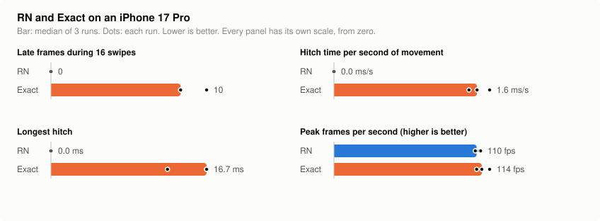

# Measurements

Results from `scripts/measure` (see its README for the method and what each column means).
All runs use release builds and LOCAL mode, alternating the apps. Values are the median, with
the lowest and highest run in brackets.

## 2026-11-19, iPhone 17 Pro

A physical iPhone 17 Pro (iOS 26.6.2) over USB, 3 runs per app. Each run: relaunch, then
Instruments' Animation Hitches records while 8 scripted swipes fling the list down and 8 fling
it back up, 3.5s apart.

| Metric | RN | Exact |
| --- | --- | --- |
| Late frames during 16 swipes | 0 (0–0) | 10 (10–12) |
| Hitch time per second of movement | 0 ms/s | 1.6 ms/s (1.5–1.7) |
| Longest hitch | none | 16.7 ms (12.5–16.7) |
| Peak frames per second | 110 (109–113) | 114 (110–120) |

Raw rows: [2026-11-19-phone.csv](2026-11-19-phone.csv).

- **RN dropped no frames** in any run. Exact delivered about 10 frames late per run, each one
  or two frames behind at 120 Hz.
- **Both are smooth by Apple's guide** (under 5 ms/s is good, over 10 a problem).
- **Both reach the 120 Hz range.** The mean frame rate is left out: the phone slows its refresh
  rate as a fling slows, so a low mean is not dropped frames.
- Why Exact drops those frames is not known yet.

## 2026-11-19, iOS Simulator

iPhone 17 Pro simulator, 5 runs per app. Each run: relaunch, 20s idle (four feed ticks), 30
swipes that move nothing, then 15 swipes down the list and 15 back up.

| Metric | RN | Exact |
| --- | --- | --- |
| CPU during 30 swipes, less the tool's share | 2.43 s (2.36–2.48) | 2.13 s (1.97–2.35) |
| CPU over 20 s idle | 0.08 s (0.07–0.09) | 0.13 s (0.12–0.17) |
| Startup | 1346 ms (1161–1368) | 1175 ms (1162–1207) |
| Memory after launch | 271 MB (269–272) | 275 MB (275–275) |
| Memory after scroll | 319 MB (318–319) | 316 MB (315–316) |

Raw rows: [2026-11-19-simulator.csv](2026-11-19-simulator.csv).

- **Scrolling:** Exact used about 12% less CPU, and every Exact run is below every RN run, by a
  thin margin (2.35 against 2.36).
- **Idle:** RN used less CPU per tick. Both are under 1% of one core.
- **Startup and memory:** within a few percent of each other. Startup includes the tool's own
  overhead.
- Simulator CPU and memory are not device numbers, so read them as RN against Exact only.

## The swipe tool distorts both

agent-device reads the app's whole accessibility tree before every swipe, and the app pays for
it on its main thread. A time profile on the phone put 80 to 85% of each app's main-thread time
during rapid swipes in that read.

- On the phone, swipes 400ms apart gave 11.5 ms/s of hitches for RN and 14.6 for Exact. Those
  were the tool. Spaced 3.5s apart, the read happens while the list is at rest.
- On the simulator, the read was about 3.6s of the 6s of CPU during the swipes. The script now
  measures it with swipes that move nothing (`tool_cpu_s`) and subtracts it.

## Not measured yet

LIVE mode, filter and sort, startup and memory on the phone, and Android.

To redraw a chart: `python3 scripts/measure/chart.py <results.csv> <out.svg> [title]`.
