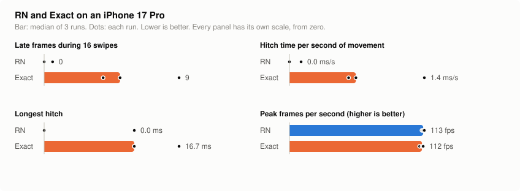
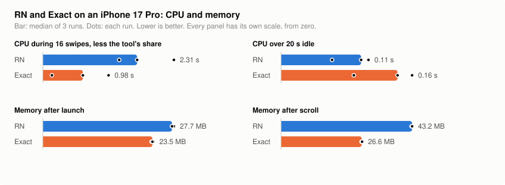
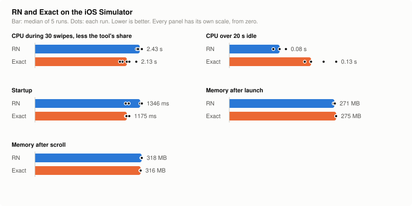

# Measurements

Results from `scripts/measure` (see its README for the method and what each column means).
All runs use release builds and LOCAL mode, alternating the apps. Values are the median, with
the lowest and highest run in brackets.

## 2026-11-26, iPhone 17 Pro

The same phone and method as the run of 2026-11-19 below, 3 runs per app, after RN's two
screens moved to a shared sort hook and shared chips.

| Metric | RN | Exact |
| --- | --- | --- |
| Late frames during 16 swipes | 0 (0–1) | 9 (7–16) |
| Hitch time per second of movement | 0 ms/s (0–0.2) | 1.4 ms/s (1.2–2.8) |
| Longest hitch | none (0–16.7 ms) | 16.7 ms (16.7–25.0) |
| Peak frames per second | 113 (112–114) | 112 (110–113) |

Raw rows: [2026-11-26-phone.csv](2026-11-26-phone.csv).

- **The same picture as a week before.** RN delivered one frame late in three runs, Exact about
  9 per run, and both stay in Apple's good band.
- **The RN refactor cost no frames.**
- **Noisier than the first run.** In three of the six runs the swipes took 84 to 107s to send,
  against 72s, so `scroll_wall_s` does not match between runs. Hitch time per second of
  movement still compares. Exact's third run was its worst (16 late frames, one of 25 ms) and
  was redone after two failed attempts.

## 2026-11-26, iPhone 17 Pro: CPU and memory

The same phone, 3 runs per app. Each run: relaunch, then Instruments' Activity Monitor records
through 20s idle (four feed ticks), 16 swipes that move nothing, and the same 16 swipes as the
frames run. Memory is the app's footprint, the number Xcode's memory gauge shows.

| Metric | RN | Exact |
| --- | --- | --- |
| CPU during 16 swipes, less the tool's share | 2.31 s (1.87–3.21) | 0.98 s (0.22–1.61) |
| CPU over 20 s idle | 0.11 s (0.07–0.12) | 0.16 s (0.10–0.18) |
| Memory after launch | 27.7 MB (27.7–28.1) | 23.5 MB (23.3–23.7) |
| Memory after scroll | 43.2 MB (43.0–43.2) | 26.6 MB (26.5–26.7) |

Raw rows: [2026-11-26-phone-cpu.csv](2026-11-26-phone-cpu.csv).

- **Memory:** Exact used 4 MB less after launch and 17 MB less after the scroll. RN grew by
  about 15 MB while scrolling, Exact by about 3 MB. The runs agree within 0.4 MB.
- **CPU to scroll:** every Exact run is below every RN run (1.61 against 1.87), but the number
  is noisy. The tool's share is 2.6 to 4.1s a run, more than what is left for the app, and it
  moves by over a second between runs.
- **Idle:** RN used less CPU per tick, and the ranges overlap. Both are under 1% of one core.

## 2026-11-26, iPhone 17 Pro: navigation

The same phone, 3 runs per app. Each run: relaunch, then Instruments' Animation Hitches records
while a tap opens the first row's detail screen and a tap on the back button returns, 8 times
(16 transitions), 3.5s apart.

| Metric | RN | Exact |
| --- | --- | --- |
| Late frames during 16 transitions | 1 (0–1) | 11 (9–13) |
| Hitch time per second of movement | 0.1 ms/s (0–0.1) | 3.3 ms/s (2.4–4.5) |
| Longest hitch | 8.3 ms (0–8.3) | 83.3 ms (75.0–83.3) |

Raw rows: [2026-11-26-phone-nav.csv](2026-11-26-phone-nav.csv).

- **RN delivered at most one frame late per run**, one refresh interval behind at 120 Hz.
- **Exact had one long hitch in every run**, 75 to 83 ms, and 9 to 13 late frames. Its hitch
  time stays under Apple's 5 ms/s, but is the highest of any run here.
- Which of the two transitions the long hitch belongs to is not known yet.

## 2026-11-19, iPhone 17 Pro

A physical iPhone 17 Pro (iOS 26.6.2) over USB, 3 runs per app. Each run: relaunch, then
Instruments' Animation Hitches records while 8 scripted swipes fling the list down and 8 fling
it back up, 3.5s apart.

| Metric | RN | Exact |
| --- | --- | --- |
| Late frames during 16 swipes | 0 (0–0) | 10 (10–12) |
| Hitch time per second of movement | 0 ms/s | 1.6 ms/s (1.5–1.7) |
| Longest hitch | none | 16.7 ms (12.5–16.7) |
| Peak frames per second | 110 (109–113) | 114 (110–120) |

Raw rows: [2026-11-19-phone.csv](2026-11-19-phone.csv).

- **RN dropped no frames** in any run. Exact delivered about 10 frames late per run, each one
  or two frames behind at 120 Hz.
- **Both are smooth by Apple's guide** (under 5 ms/s is good, over 10 a problem).
- **Both reach the 120 Hz range.** The mean frame rate is left out: the phone slows its refresh
  rate as a fling slows, so a low mean is not dropped frames.
- Why Exact drops those frames is not known yet.

## 2026-11-19, iOS Simulator

iPhone 17 Pro simulator, 5 runs per app. Each run: relaunch, 20s idle (four feed ticks), 30
swipes that move nothing, then 15 swipes down the list and 15 back up.

| Metric | RN | Exact |
| --- | --- | --- |
| CPU during 30 swipes, less the tool's share | 2.43 s (2.36–2.48) | 2.13 s (1.97–2.35) |
| CPU over 20 s idle | 0.08 s (0.07–0.09) | 0.13 s (0.12–0.17) |
| Startup | 1346 ms (1161–1368) | 1175 ms (1162–1207) |
| Memory after launch | 271 MB (269–272) | 275 MB (275–275) |
| Memory after scroll | 319 MB (318–319) | 316 MB (315–316) |

Raw rows: [2026-11-19-simulator.csv](2026-11-19-simulator.csv).

- **Scrolling:** Exact used about 12% less CPU, and every Exact run is below every RN run, by a
  thin margin (2.35 against 2.36).
- **Idle:** RN used less CPU per tick. Both are under 1% of one core.
- **Startup and memory:** within a few percent of each other. Startup includes the tool's own
  overhead.
- Simulator CPU and memory are not device numbers, so read them as RN against Exact only.

## The swipe tool distorts both

agent-device reads the app's whole accessibility tree before every swipe, and the app pays for
it on its main thread. A time profile on the phone put 80 to 85% of each app's main-thread time
during rapid swipes in that read.

- On the phone, swipes 400ms apart gave 11.5 ms/s of hitches for RN and 14.6 for Exact. Those
  were the tool. Spaced 3.5s apart, the read happens while the list is at rest.
- On the simulator, the read was about 3.6s of the 6s of CPU during the swipes. The script now
  measures it with swipes that move nothing (`tool_cpu_s`) and subtracts it.

## Not measured yet

LIVE mode, filter and sort, startup on the phone, and Android.

To redraw a chart: `python3 scripts/measure/chart.py <results.csv> <out.svg> [title]`.
